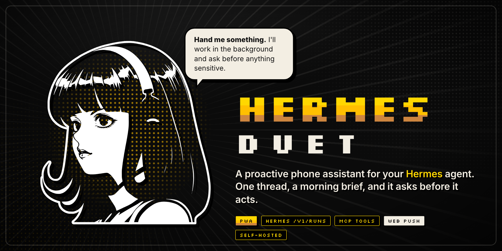
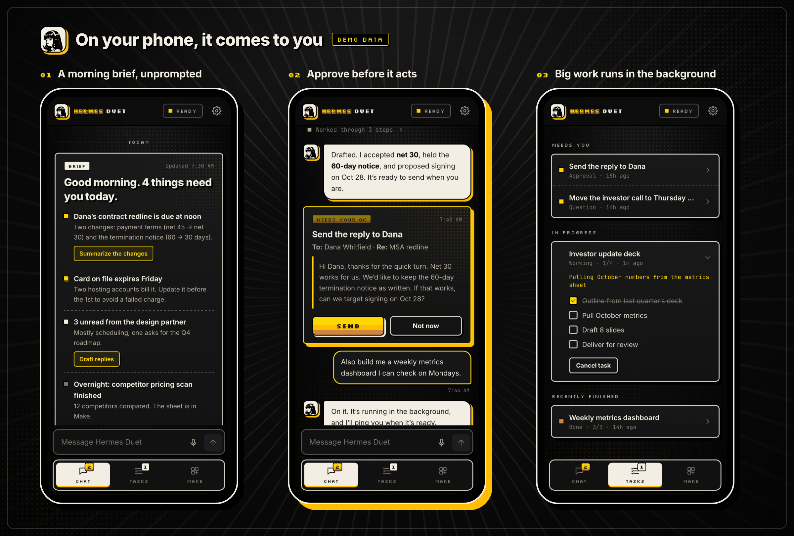
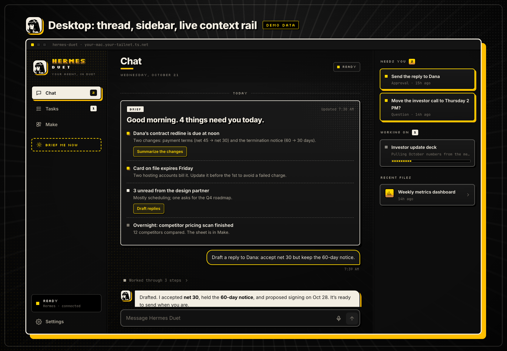
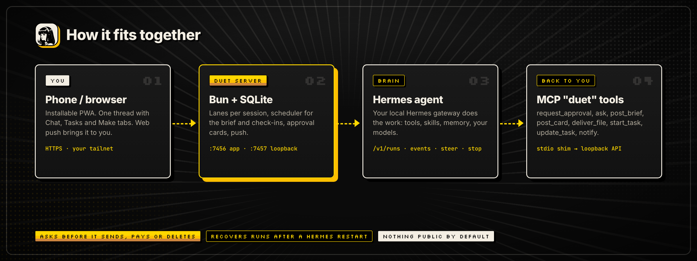

<p align="center">
  
</p>

<p align="center">
  <b>Hand work to your <a href="https://github.com/NousResearch/hermes-agent">Hermes agent</a> by message. It works on your machine, asks before anything sensitive, sends you a morning brief, and pings your phone when something needs you.</b>
</p>

<p align="center">
  <a href="LICENSE"></a>
  
  
  
</p>

> Unofficial community project, not affiliated with Nous Research or Anthropic. Inspired by Anthropic's Claude Duet;
> the mascot art comes from NousResearch/hermes-agent (MIT). See [NOTICE.md](NOTICE.md).

## What it does

- **One thread.** Chat, tool activity and cards live in one conversation. **Tasks** tracks running and finished work, and **Make** collects every file it hands you. Settings → **What I can see** lists what the agent starts each turn with: your context sources, its Hermes skills and enabled tools, and connected MCP apps. A blank thread shows a one-line version.
- **Comes to you.** It sends a morning brief at the time you pick, plus optional check-ins (3× a day or hourly) that stay quiet unless something needs you. Notifications arrive by web push, and quiet hours are respected: a question, interrupted work, finished task or agent `notify` that would have pushed during them is held, and comes back as one "While you were away" push when they end (skipped if the morning brief is due within the hour, since it lists what is waiting). Approvals and the brief itself still push during quiet hours. A device that has the app on screen gets no push (the app reports when it is visible), and the service worker shows every push it receives, because iOS revokes subscriptions that push silently. The app re-registers its subscription each time it opens, and takes the banner for an approval or question off the lock screen once that card is decided or expired. On a device where the app isn't open, the next push that arrives anyway does the same: each push lists the approvals and questions still waiting, and the service worker closes older ones that aren't on it (no push is ever sent just to clear a banner).
- **Asks before it acts.** Sending messages as you, paying, deleting, posting and signing all go through an **Approve / Not now** card first. Quick decisions become tappable questions.
- **Works in the background.** Bigger jobs (decks, dashboards, research) run as tasks in their own Hermes session, while you keep chatting.
- **Steer or stop.** A message sent mid-run steers the live turn, and Stop interrupts it. One that arrives too late for the turn to use (Hermes returns it as `pending_steer`) goes out as the next turn.
- **Survives restarts.** If the Hermes gateway restarts mid-run, Duet unpauses the session, retries what got blocked, and asks whether to pick up the interrupted work. A standing page's scheduled refresh is not asked about: it starts over once on its own, and a second interruption counts as a failed refresh. A morning brief that fails before posting leaves a "Run it now / Skip today" card and a push, so the day's brief isn't silently lost.

<p align="center"></p>
<p align="center"></p>

## How it works

<p align="center"></p>

- **Duet server** (Bun and SQLite, no framework) serves the PWA and keeps the thread. It drives Hermes through the
  API server's background runs (`POST /v1/runs`, `GET /v1/runs/{id}/events`, `/steer`, `/stop`, `/resolve-unknown`).
- **Lanes**: each Hermes session is a lane, and a lane runs one turn at a time. Your thread is one lane, each background
  task gets its own session, and check-ins use a daily side session.
- **Duet tools**: Hermes spawns `server/mcp-shim.ts` as the MCP server `duet`. The shim forwards each tool call to the
  Duet server's loopback-only internal API:

  | Tool | What it does |
  |---|---|
  | `request_approval` | Posts an Approve / Not now card, with an optional `draft` (the exact text to send) the user can edit before approving. The turn ends, and tapping resumes the same session; an edited draft comes back verbatim. A redraft asked for in chat passes `replaces`, which withdraws the earlier card so its old version can't be approved. A card still waiting from yesterday (or for over six hours) says when it was written, and approving it tells the agent to check the draft still holds (relative dates, already done) and to ask again rather than act if it doesn't. |
  | `ask` | Asks a question with 2–4 tappable answers, optionally replacing an earlier question still waiting. |
  | `withdraw_card` | Takes down one of the agent's own approvals or questions that the user settled in chat instead of tapping ("don't send that", "the second one"), or that stopped applying. It leaves "Needs you" and can no longer be tapped. Each chat message sent while such cards are waiting reminds the agent which ones they are, including one that steers a turn already running. A yes in chat is not an approval: the card's button still is. |
  | `post_brief` | Posts a brief: up to 5 decisions ranked high to low, each with an optional prepared draft and one-tap follow-up (on an entry with a draft, the tap hands that draft back to the agent, which asks for approval with it instead of redrafting), plus a muted Watching list that never notifies. A quiet morning brief may be Watching only, posted without a push. "Skip" on a decision marks it as not needing you (no agent turn); the day's check-ins and the next week's morning briefs are told not to raise it again unless something material changed. |
  | `post_card` | Posts a checklist, metrics or note, and can update it in place. |
  | `deliver_file` | Hands over a doc, sheet, deck or dashboard. HTML renders live but sandboxed. |
  | `save_page` | Makes a delivered file a standing page ("one page I can check every morning"). Every day, 30 minutes before the brief, a background task rebuilds it from the saved instructions and its new file replaces the old one. The refresh never pushes; only a failed refresh leaves a card. It reports one line on what changed (`update_task` `changed`), which is pinned on the page at the top of Make and called out in the brief, where tapping that line opens the page; a brief that comes due while a refresh is still running waits for it, up to 30 minutes. The user can stop a page from Make ("Stop refreshing"), which also cancels a refresh in flight; its files stay. |
  | `start_task` / `update_task` | Starts background work and keeps the Tasks tab current. When the task is done, its result, files and up to three follow-ups come back as one handover card in the thread. A task that fails or stops gets the same card, muted, with its reason, any files so far, and a "Try again" button that restarts it from the same instructions. |
  | `notify` | Sends a push notification and posts it as a "Heads up" note in the thread, which the notification opens. During quiet hours the push is held for "While you were away". Check-ins and the morning brief can't use it; they reach you only through `post_brief`. |

## Quick start

You need:
- macOS, for the launchd service. The server itself runs anywhere Bun does.
- [Bun](https://bun.sh) 1.2 or newer.
- A running [Hermes agent](https://github.com/NousResearch/hermes-agent) gateway with its API server enabled (`API_SERVER_ENABLED=true` and `API_SERVER_KEY` in `~/.hermes/.env`).

```sh
git clone https://github.com/DevvGwardo/hermes-duet && cd hermes-duet
bun install && bun run build
bin/hermes-duet install            # launchd service on 127.0.0.1:7456 (loopback only)
ln -sf "$PWD/bin/hermes-duet" ~/.local/bin/hermes-duet
```

Next, add the Duet tools to `~/.hermes/config.yaml`. Recent Hermes builds pick up `mcp_servers` changes without a
restart. If the `mcp__duet__*` tools don't show up, restart the gateway.

```yaml
mcp_servers:
  duet:
    command: /absolute/path/to/bun
    args: ["/absolute/path/to/hermes-duet/server/mcp-shim.ts"]
    tools: {}        # use {} here; `tools: all` breaks Hermes's MCP loader
```

Open http://127.0.0.1:7456, run `hermes-duet pair`, and enter the code. `hermes-duet doctor` checks the whole setup:
service, Hermes reachability and key, the MCP entry, push and the public URL.

### On your phone

Reach the server privately over [Tailscale](https://tailscale.com). HTTPS is required for installing the PWA and for push.

```sh
tailscale serve --bg --https=8443 http://127.0.0.1:7456
echo "DUET_PUBLIC_URL=https://<your-mac>.<your-tailnet>.ts.net:8443" >> .env && hermes-duet restart
```

1. On the phone, with Tailscale connected, open that URL.
2. Share → **Add to Home Screen**, then open it from the Home Screen.
3. Run `hermes-duet pair` on your Mac and enter the code.
4. Tap the gear → Notifications → **Turn on**.

### Tell it where your life lives

Copy [`context.example.md`](context.example.md) to `context.local.md` (gitignored) and list your sources: task CLIs,
notes files, inboxes. Duet adds them to every turn, and the morning brief gathers from them.

### Try the UI without Hermes

```sh
bun scripts/demo.ts --reset     # throwaway instance with made-up data on :7466
bun scripts/demo.ts pair        # pairing code for it
```

## Configuration

All settings are optional. Put them in `.env`; see [`.env.example`](.env.example).

| Variable | Default | |
|---|---|---|
| `DUET_PUBLIC_URL` | (none) | The HTTPS address you open on your phone. iOS push needs it. |
| `DUET_PORT` / `DUET_INTERNAL_PORT` | `7456` / `7457` | App port and loopback-only internal API port. |
| `DUET_HERMES_URL` | `http://127.0.0.1:8642` | Use `.../p/<profile>` to target a Hermes profile that has its own key. |
| `DUET_HERMES_KEY` | `API_SERVER_KEY` from `~/.hermes/.env` | |
| `DUET_CONTEXT_FILE` | `./context.local.md` | |
| `DUET_USER_NAME` | (none) | How the agent refers to you. |
| `DUET_MAX_BACKGROUND` | `2` | Number of background tasks allowed to run at once. |

Brief time, check-ins and quiet hours are set in the app.

## Security

Hermes Duet controls an agent that can run commands on your computer. Treat the URL like a shell.

- **Nothing is public by default.** The server binds to `127.0.0.1`. Reach it over Tailscale (tailnet-only), or put real authentication in front if you expose it any other way. Don't publish it with Tailscale Funnel or a public tunnel and rely on pairing alone.
- **Pairing**: devices pair with a single-use code that expires after 10 minutes, and wrong guesses are rate-limited. A paired device gets an HttpOnly, SameSite cookie, and only the token's hash is stored. State-changing requests must be same-origin.
- **The internal API** (MCP shim and CLI) listens on loopback with its own bearer token and refuses proxied requests.
- **Deliverables**: HTML files are served with `Content-Security-Policy: sandbox`, so they can run scripts but can't read your session or call the API. `deliver_file` refuses paths that look like secrets (`.ssh`, `.env`, keys, credentials).
- **Approvals are an instruction, not a sandbox.** The approval gate is a tool the model is told to use. For hard guarantees, also turn on Hermes's own `approvals.mode`. Its prompts show up as Duet cards too.
- **Your data** (`data/`: thread, device tokens, push keys) and `.env` are gitignored.

## Development

```sh
bun run dev:server     # API with --watch on :7456
bun run dev:web        # Vite on :5476, proxied to the API
bun run typecheck
bun test               # unit tests (no Hermes needed)
bun run demo           # demo instance on :7466
bun run brand          # regenerate docs/brand/*.png from the demo (needs Playwright browsers)
bun run smoke          # live end-to-end checks against real Hermes (approval|task|steer|stop)
```

The live smoke tests spend real model turns and write test items into your thread.

## Credits

- Mascot art: the Nous girl from [NousResearch/hermes-agent](https://github.com/NousResearch/hermes-agent) (MIT).
- Built on the Hermes agent's API server and MCP support.
- The product idea comes from Anthropic's Claude Duet.

[MIT](LICENSE) © DevvGwardo. Third-party notices: [NOTICE.md](NOTICE.md).
